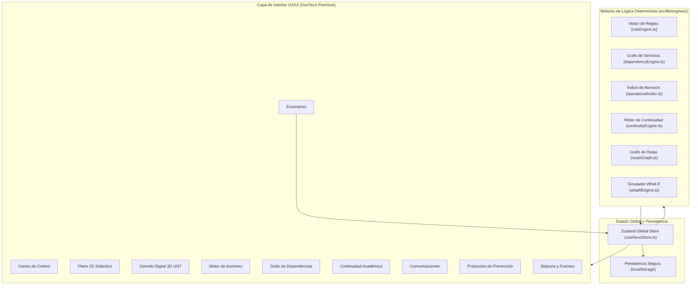

# NEXO UNT — Preparación, Coordinación y Continuidad Universitaria

**Plataforma GovTech de Continuidad Operativa y Gestión del Riesgo de Desastres ante el Fenómeno El Niño**  
Desarrollada para la **Hackathon Innova Norte 3G 2026** — *Universidad Nacional de Trujillo (UNT)*  
**Desafío 3:** Gestión de riesgos y desastres ante el Fenómeno El Niño.

> **Aviso institucional:** Prototipo académico de alta fidelidad desarrollado para concurso. Opera sobre escenarios, datos y modelos sintéticos verificables. No reemplaza los canales ni sistemas de alerta temprana oficiales del Estado peruano (SENAMHI / INDECI / COEN).

---

## 1. Propuesta de Valor

> ### *"Del aviso oficial a una acción verificable."*

Durante emergencias causadas por lluvias intensas o huaicos asociados al Fenómeno El Niño en Trujillo, la interrupción en cadena de servicios críticos (electricidad, agua potable, conectividad y accesos viales) suele paralizar las actividades universitarias sin alternativas claras. La información dispersa y la falta de trazabilidad retrasan la toma de decisiones.

**NEXO UNT** conecta de extremo a extremo:
```
AVISO OFICIAL → ESCENARIO SINTÉTICO → REGLAS DETERMINISTAS → SERVICIOS AFECTADOS 
  → ACCIONES ASIGNADAS → EVALUACIÓN DE CONTINUIDAD → COMUNICACIÓN APROBADA → AUDITORÍA
```

Su **diferenciador principal** es un **motor determinista de dependencias operativas y reglas explicables**, complementado con un **Gemelo Digital 3D interactivo del campus** y un visualizador territorial 2D que identifican con precisión las zonas de anegamiento y dependencias de servicio sin recurrir a cajas negras de IA.

---

## 2. Marco Normativo de Referencia

La arquitectura y los flujos de decisión de NEXO UNT se alinean con la normativa vigente del Estado peruano:
* **Ley N° 29664:** Sistema Nacional de Gestión del Riesgo de Desastres (**SINAGERD**). Componentes de Gestión Prospectiva, Correctiva y Reactiva.
* **D.S. N° 048-2011-PCM:** Reglamento de la Ley SINAGERD (articulación de planes de contingencia y continuidad de servicios públicos).
* **D.S. N° 115-2022-PCM:** Plan Nacional de Gestión del Riesgo de Desastres (**PLANAGERD 2022-2030**).
* **R.M. N° 188-2015-PCM:** Lineamientos para la Gestión de la Continuidad Operativa de las entidades públicas.

---

## 3. Matriz de Cobertura de Criterios del Desafío 3

| Criterio del Concurso | Peso | Implementación en NEXO UNT |
| :--- | :---: | :--- |
| **Funcionalidad** | 25 pts | **100% interactivo y conectado:** 10 módulos funcionales, 5 escenarios ficticios, 6 roles con permisos estrictos, motor de dependencias, cálculo determinista de índice operativo y modo demo de 90s. |
| **Innovación** | 15 pts | **Gemelo Digital 3D (Three.js) + Grafo de Dependencias:** Visualizador espacial 3D con cotas de anegamiento y recálculo automático de rutas de evacuación seguras ante vías bloqueadas. |
| **Problema y Usuario** | 15 pts | **Diseño centrado en el ecosistema UNT:** Resuelve la descoordinación entre autoridades, brigadas, docentes y estudiantes frente a inundaciones en la Ciudad Universitaria. |
| **Validación** | 15 pts | **Matriz de roles y casos de uso:** Flujos específicos para Estudiante, Docente, Administrativo, Brigadista, Coordinador GRD y Autoridad Universitaria. |
| **Viabilidad** | 15 pts | **GovTech Offline-First:** Funciona sin conexión a internet (persistencia en `localStorage`), compatible con Docker y cero costo recurrente en servidores externos obligatorios. |
| **Seguridad** | 10 pts | **Privacidad & Gobernanza:** Sin datos personales reales, contenedor Docker con usuario no privilegiado (`node`), validación humana obligatoria antes de emitir comunicados. |
| **Pitch & Demo** | 5 pts | **Modo Demostración Integrado:** Secuencia guiada automatizada de 90 segundos que expone el ciclo completo ante el jurado calificador. |

---

## 4. Arquitectura y Módulos del Sistema



### Detalle de Módulos Funcionales

1. **Centro de Control (`/`):** Dashboard ejecutivo con el Índice de Atención Operativa Simulado (0–100), instalaciones comprometidas, acciones prioritarias y gráficos de evolución.
2. **Explorador Territorial Dual (`/map`):**
   * **Modo Gemelo Digital 3D:** Construido con **Three.js** y **CSS2DRenderer**, con perspectiva isométrica y cenital calibrada al campus de la UNT, simulación solar en tiempo real, canales pluviales deprimidos (`CN-01`), zonas de anegamiento (`PZ-ACC1`, etc.) y tintado dinámico de techos según riesgo operativo.
   * **Modo Plano 2D Didáctico:** Capas vectoriales interactivas de servicios, zonas de riesgo y rutas de evacuación alternativas.
   * **Modo OpenStreetMap:** Cartografía territorial de Trujillo para contexto macro.
3. **Escenarios de Simulación (`/scenarios`):** 5 escenarios preconfigurados (*Lluvia intensa 68%, Interrupción eléctrica, Acceso restringido, Pérdida de conectividad, Recuperación progresiva*) con simulador *"¿Qué pasaría si...?"*.
4. **Dependencias Operativas (`/dependencies`):** Grafo interactivo que propaga estados de "requiere verificación técnica" ante caídas de luz, agua o enlaces de red sin inventar daños no confirmados.
5. **Motor de Acciones (`/actions`):** Generación automática de tareas trazables con responsable, nivel de prioridad y seguimiento de ciclo de vida (*Pendiente → En Revisión → Verificada → Cerrada*).
6. **Continuidad Universitaria (`/continuity`):** Evaluación de 8 actividades académicas/administrativas con propuestas deterministas: presencial, virtual/remota (solo si hay conectividad y electricidad), reprogramación o suspensión temporal.
7. **Comunicaciones Institucionales (`/communications`):** Editor de avisos con flujo de aprobación humana obligatoria (*Borrador → Revisión → Aprobación de Autoridad → Difusión simulada a 5 buzones institucionales*).
8. **Prevención y Contingencia (`/prevention`):** Protocolos clasificados en fases *Antes, Durante y Después*, rutas referenciales y puntos de encuentro (`PF-01`, `PF-02`).
9. **Explicabilidad Transparente (`/explainability`):** Desglose paso a paso de fórmulas, variables y reglas activadas (*"¿Por qué NEXO recomienda esto?"*).
10. **Bitácora y Auditoría (`/sources`):** Trazabilidad cronológica inmutable con exportación de datos en formato JSON y CSV.

---

## 5. Roles y Gobernanza

El sistema cuenta con un selector de roles activo que restringe las acciones conforme a los protocolos institucionales:

* 🎓 **Estudiante:** Consulta comunicados oficiales aprobados, estado de sus clases y confirma lectura de avisos preventivos.
* 👨‍🏫 **Docente:** Consulta la operatividad de sus facultades y las alternativas pedagógicas propuestas.
* 💼 **Personal Administrativo:** Registra incidencias técnicas y da seguimiento a tareas de infraestructura.
* 🦺 **Brigadista Universitario:** Ejecuta verificaciones en campo y valida protocolos de mitigación física (achique, costales).
* 🛡️ **Coordinador GRD:** Gestiona escenarios de riesgo, dependencias y borrador de acciones de respuesta.
* 🏛️ **Autoridad Universitaria:** Revisa, aprueba o rechaza formalmente las decisiones de continuidad y comunicados públicos.

---

## 6. Stack Tecnológico

* **Frontend:** React 19, TypeScript estricto, Vite, Tailwind CSS, Framer Motion, Lucide React, Recharts.
* **Modelado Espacial 3D:** Three.js, OrbitControls, CSS2DRenderer (etiquetas y badges en espacio 3D).
* **Cartografía 2D:** Leaflet, React-Leaflet, OpenStreetMap.
* **Gestión de Estado:** Zustand con selectores derivados y sincronización determinista.
* **Pruebas y Verificación:** Node.js Test Runner con TypeScript nativo (`tsx --test`), 13 tests unitarios y de integración deterministas.
* **Contenerización:** Docker multi-etapa sobre `node:22-alpine` con healthcheck integrado.

---

## 7. Ejecución y Despliegue

### Requisitos Previos
* Node.js 22 LTS (o Docker Desktop).

### Opción A: Desarrollo Local

```bash
# 1. Clonar e instalar dependencias
git clone https://github.com/marck/nexo-unt.git
cd nexo-unt
npm install

# 2. Ejecutar suite de pruebas unitarias
npm test

# 3. Compilar aplicación
npm run build

# 4. Iniciar servidor de desarrollo
npm run dev
```

La aplicación iniciará en `http://localhost:5173`.

---

### Opción B: Despliegue con Docker Compose (Recomendado)

```bash
# 1. Construir e iniciar el contenedor en segundo plano
docker compose up -d --build

# 2. Verificar estado de salud (healthcheck)
docker compose ps

# 3. Consultar logs
docker compose logs -f
```

La aplicación estará lista para producción en **`http://localhost:3000`** con endpoint de verificación en `/api/health`.

Para detener el servicio:
```bash
docker compose down
```

---

## 8. Calidad y Verificación de Software

El proyecto cuenta con verificación estricta y reproducible:

```bash
# Ejecución de pruebas deterministas de los motores
npm test

# Verificación de tipos TypeScript y build de producción
npm run build
```

**Resultado de las pruebas:**
- `calculateOperationalIndex`: Ponderación exacta y clasificación 0–100.
- `evaluateDependencies`: Propagación de verificación sin falsos positivos.
- `dependencyEngine`: Prevención y detección de ciclos en grafos dirigidos.
- `ruleEngine`: Disparo consistente sin duplicación de acciones en reevaluaciones.
- `continuityEngine`: Bloqueo estricto de virtualidad sin conectividad comprobada.
- `routeGraph`: Recálculo de ruta alterna ante segmentos anegados.
- `demoSequence`: Validación del flujo de 90 segundos para exposición ante jurado.

---

## 9. Licencia y Créditos

Proyecto desarrollado por el equipo participante en la **Hackathon Innova Norte 3G 2026** de la **Universidad Nacional de Trujillo**. Distribuido bajo licencia MIT.
